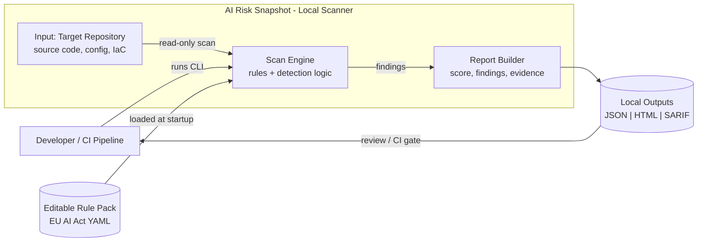

# High-Level System Design — AI Risk Snapshot

This folder documents the high-level architecture of the AI Risk Snapshot project.
The diagram is written in **Mermaid** (plain text), so GitHub renders it directly —
no image files (SVG/PNG) are used.

## System Design

## In one paragraph

A developer or CI pipeline runs the **AI Risk Snapshot** CLI against a **target
repository**. The scanner reads the repository (read-only, no execution, no network)
and applies an **editable EU AI Act rule pack** to produce findings. A **report
builder** turns those findings into a score, grouped evidence and three local
artefacts — `report.json`, a self-contained `report.html` dashboard, and
`report.sarif` — which the developer reviews or the CI pipeline uses as a gate.

## Key properties

- Everything runs **locally**; no data leaves the machine.
- Rules live in a separate YAML pack and can be edited without changing the engine.
- Scanning is **static and read-only** — scanned code is never executed.
- Outputs are deterministic, with exit codes for CI (`0` pass, `1` threshold met, `2` error).

## Files

| File | Purpose |
|---|---|
| `README.md` | This document; renders the diagram on GitHub. |
| `system-design-architecture.mmd` | Raw Mermaid source for the same diagram (editable). |
