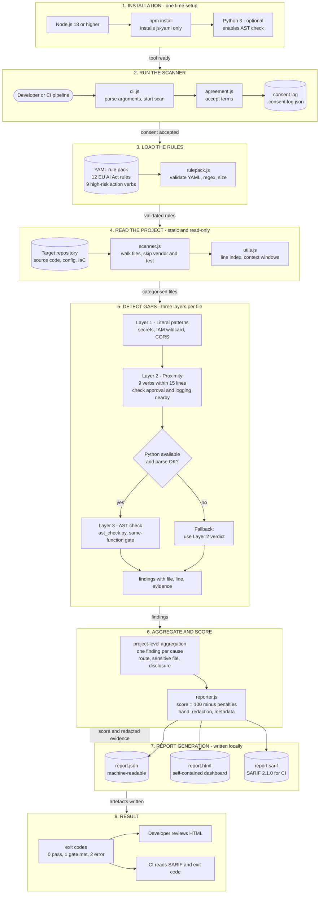

# How AI Risk Snapshot Works — From Installation to Report

This page explains the working of the **AI Risk Snapshot** system in **one diagram**.
It is written in **Mermaid** (plain text), so GitHub renders it directly — no image
files (SVG/PNG) are used.

The diagram follows the complete journey a faculty member needs to understand:
installing the tool, running a scan, loading the rules, reading the project, detecting
gaps, scoring them, generating the report, and finally reading the result.

## The complete process in one diagram

## Explanation of each stage

1. **Installation (one-time setup).** The tool needs Node.js 18 or higher. Running
   `npm install` installs the only runtime dependency, `js-yaml`. Python 3 is
   **optional** — if present, it enables the deeper AST check in Layer 3.

2. **Run the scanner.** A developer (or a CI pipeline) starts the CLI (`cli.js`),
   which parses the command-line arguments. Before scanning, `agreement.js` presents
   the terms of use and records the user's acceptance in a local consent log
   (`.consent-log.json`).

3. **Load the rules.** The YAML rule pack — 12 rules mapped to the EU AI Act and
   9 high-risk action verbs — is loaded and validated by `rulepack.js` (field checks,
   regex validity, and a size limit) before any file is read.

4. **Read the project.** The target repository is scanned **statically and read-only**:
   `scanner.js` walks the directories, skips vendor and test paths, categorises each
   file, and `utils.js` builds a line index and context windows. No file is executed
   and no network request is made.

5. **Detect gaps (three layers, per file).** Layer 1 matches literal patterns such as
   hardcoded secrets, IAM wildcards and permissive CORS. Layer 2 performs proximity
   analysis — if one of the 9 high-risk verbs appears within 15 lines, it checks for
   nearby approval and logging. Layer 3 is an optional AST check through
   `ast_check.py` that confirms the same-function approval gate. If Python is not
   available or parsing fails, the tool falls back to the Layer 2 verdict. Each gap
   becomes a finding with the file, line and evidence.

6. **Aggregate and score.** Findings are collected at project level (one finding per
   cause, with route-auth, sensitive-file and disclosure checks). `reporter.js`
   computes `score = 100 − penalties`, assigns a risk band, applies redaction, and
   adds applicability metadata.

7. **Report generation.** Three local artefacts are written: `report.json`
   (machine-readable), `report.html` (a self-contained dashboard), and `report.sarif`
   (SARIF 2.1.0 for CI tools).

8. **Result.** The process exits with a deterministic code — `0` pass, `1` gate met,
   `2` error. The developer reviews the HTML dashboard, while CI reads the SARIF file
   and the exit code to decide whether to pass or fail the build.

## Key properties

- Runs entirely **locally** — no data leaves the machine.
- Rules live in a separate YAML pack and can be edited without changing the engine.
- Scanning is **static and read-only** — scanned code is never executed.
- Three detection layers, with a documented fallback when Python is absent.
- Deterministic outputs and exit codes (`0` pass, `1` gate met, `2` error) for CI.

## Files

| File | Purpose |
|---|---|
| `README.md` | This document; renders the single diagram on GitHub. |
| `system-design-architecture.mmd` | Raw Mermaid source for the same diagram (editable). |
