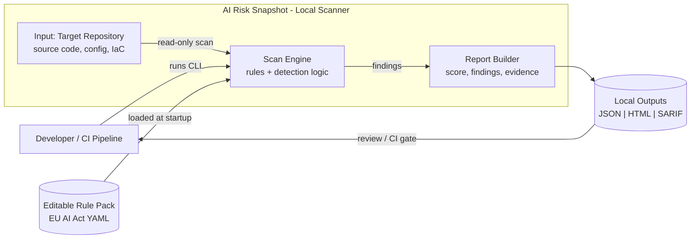
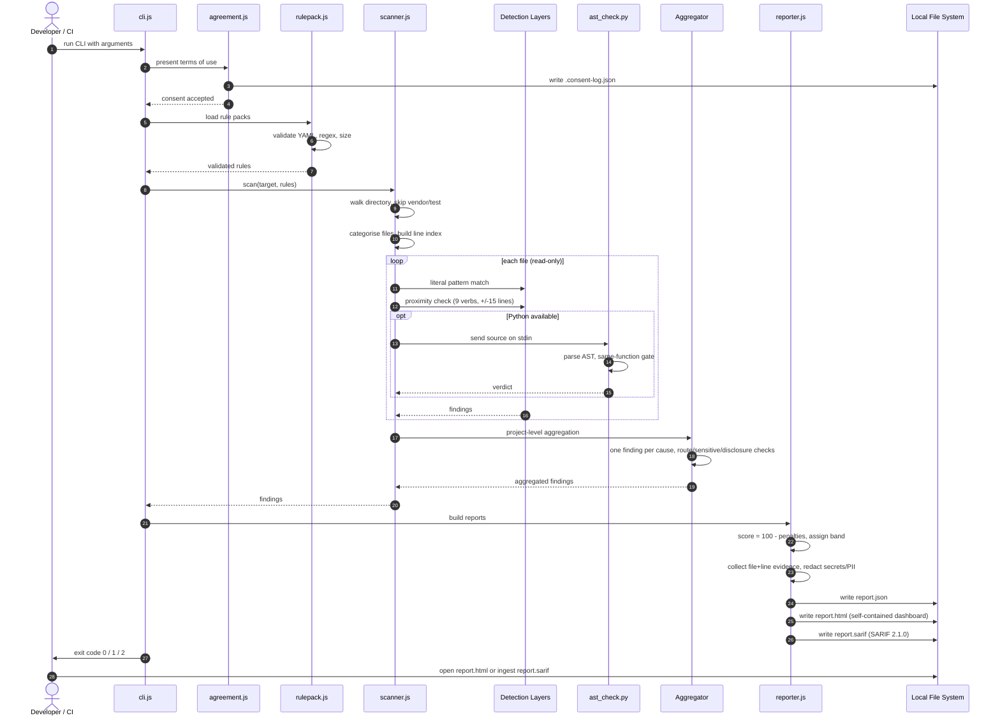

# System Design — AI Risk Snapshot

This folder documents the architecture of AI Risk Snapshot using **Mermaid** text
diagrams. GitHub renders them directly — no image files (SVG/PNG) are used.

## 1. High-level design

The developer or CI pipeline runs the CLI against a target repository. The scanner
reads the repository (read-only, no execution, no network) and applies an editable
EU AI Act rule pack. The report builder turns findings into a score and three local
artefacts — `report.json`, `report.html`, `report.sarif`.

## 2. Detailed design — from invocation to report generation

```mermaid
flowchart TB
    %% PHASE 1
    subgraph P1["PHASE 1 - INVOCATION AND CONSENT"]
        direction LR
        START(["Developer / CI runs CLI"])
        ARGS["cli.js<br/>parse arguments<br/>--yes, --format, --fail-on"]
        TERMS["agreement.js<br/>show terms of use"]
        CONSENT[("Consent Log<br/>.consent-log.json")]
        START --> ARGS --> TERMS --> CONSENT
    end

    %% PHASE 2
    subgraph P2["PHASE 2 - RULE PACK LOADING"]
        direction LR
        EU[("eu_ai_act.yaml<br/>12 rules, article mapping")]
        HA[("high_risk_actions.yaml<br/>9 high-risk verbs")]
        VALID["rulepack.js<br/>validate regex, fields, size <= 256 KiB"]
        EU --> VALID
        HA --> VALID
    end

    %% PHASE 3
    subgraph P3["PHASE 3 - FILE DISCOVERY AND CATEGORISATION"]
        direction LR
        WALK["scanner.js<br/>walk target directory"]
        FILTER["apply skip rules<br/>vendor, node_modules, test paths"]
        CAT["categorise files<br/>source, IaC, config, .env, JSON"]
        IDX["utils.js<br/>build line index + windows"]
        WALK --> FILTER --> CAT --> IDX
    end

    %% PHASE 4
    subgraph P4["PHASE 4 - DETECTION LAYERS (per file)"]
        direction TB
        L1["L1 Literal Matching<br/>secrets, IAM wildcard, CORS,<br/>unsafe deserialization, error leakage"]
        L2["L2 Proximity Analysis<br/>9 action verbs within +/-15 lines<br/>check approval + logging nearby"]
        L3["L3 AST Verification (optional)<br/>ast_check.py via stdin<br/>same-function approval gate"]
        FB{"Python available<br/>and parse OK?"}
        L1 --> L2 --> FB
        FB -->|"yes"| L3
        FB -->|"no"| FALL["Fallback:<br/>inconclusive verdict -> use L2"]
        L3 --> FALL2["confirmed / narrowed finding"]
        FALL --> FALL2
    end

    %% PHASE 5
    subgraph P5["PHASE 5 - PROJECT LEVEL AGGREGATION"]
        direction LR
        AGG["Aggregator<br/>one finding per cause"]
        ROUTE["route auth check<br/>HTTP_NO_AUTH"]
        SENS["sensitive filename check<br/>SENSITIVE_DATA"]
        DISC["disclosure check<br/>NO_AI_DISCLOSURE"]
        ROUTE --> AGG
        SENS --> AGG
        DISC --> AGG
    end

    %% PHASE 6
    subgraph P6["PHASE 6 - SCORING AND BANDING"]
        direction LR
        SCORE["reporter.js<br/>score = 100 - penalties<br/>Critical 25, High 15, Medium 5, Low 2"]
        BAND["assign band<br/>Good / Moderate / Elevated / Severe"]
        META["applicability metadata<br/>agent-tool percentage, frameworks"]
        SCORE --> BAND --> META
    end

    %% PHASE 7
    subgraph P7["PHASE 7 - EVIDENCE AND REDACTION"]
        direction LR
        EV["collect evidence<br/>file, line, masked excerpt"]
        RED["redact secrets, emails, PII<br/>at report build time"]
        EV --> RED
    end

    %% PHASE 8
    subgraph P8["PHASE 8 - REPORT GENERATION"]
        direction TB
        RED --> RJSON & RHTML & RSARIF
        RJSON["report.json<br/>machine-readable findings"]
        RHTML["report.html<br/>self-contained dashboard<br/>score, band, grouped findings"]
        RSARIF["report.sarif<br/>SARIF 2.1.0<br/>stable partial fingerprints"]
    end

    %% PHASE 9
    subgraph P9["PHASE 9 - EXIT AND DELIVERY"]
        direction LR
        EXIT["exitcodes.js<br/>0 pass / 1 gate met / 2 error"]
        REVIEW["Developer reviews HTML"]
        GATE["CI reads SARIF + exit code"]
        EXIT --> REVIEW
        EXIT --> GATE
    end

    P1 -->|"consent accepted"| P2
    P2 -->|"validated rules"| P3
    P3 -->|"categorised files"| P4
    P4 -->|"findings"| P5
    P5 -->|"all findings"| P6
    P6 -->|"score + band"| P7
    P7 -->|"redacted evidence"| P8
    P8 -->|"artefacts written"| P9
    RHTML -.->|"open locally"| REVIEW
    RSARIF -.->|"ingest"| GATE
```

## 3. Sequence — one scan from start to report files

## Key properties

- Everything runs **locally**; no data leaves the machine.
- Rules live in a separate YAML pack, editable without engine changes.
- Scanning is **static and read-only** — scanned code is never executed.
- Detection has three layers with a documented fallback when Python is absent.
- Outputs are deterministic, with exit codes for CI (`0` pass, `1` threshold met, `2` error).

## Files

| File | Purpose |
|---|---|
| `README.md` | Renders all three diagrams on GitHub. |
| `system-design-architecture.mmd` | Raw Mermaid source — high-level design. |
| `system-design-detailed.mmd` | Raw Mermaid source — detailed phase-by-phase design. |
| `sequence-flow.mmd` | Raw Mermaid source — scan sequence. |
