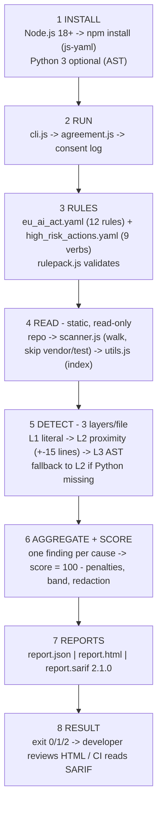

# How AI Risk Snapshot Works — From Installation to Report

This page explains the working of **AI Risk Snapshot** in **one compact Mermaid
diagram**. It is plain text, so GitHub renders it directly — no image files
(SVG/PNG) are used.

## The complete process in one diagram

## Explanation of each stage

1. **INSTALL** — Node.js 18+ is required; `npm install` adds the only dependency,
   `js-yaml`. Python 3 is optional and enables the AST check in Layer 3.
2. **RUN** — a developer or CI pipeline starts `cli.js`, which accepts the terms of
   use through `agreement.js` and writes a local consent log.
3. **RULES** — `eu_ai_act.yaml` (12 rules) and `high_risk_actions.yaml` (9 verbs)
   are loaded and validated by `rulepack.js`.
4. **READ** — the target repository is scanned statically and read-only:
   `scanner.js` walks files and skips vendor/test paths, `utils.js` builds the line
   index. No file is executed and no network request is made.
5. **DETECT** — three layers run per file: literal patterns (secrets, IAM, CORS),
   proximity over nine verbs within 15 lines, and the optional `ast_check.py`
   same-function gate. If Python is missing or parsing fails, the tool falls back
   to the Layer 2 verdict.
6. **AGGREGATE + SCORE** — findings are reduced to one per cause; `reporter.js`
   computes `score = 100 − penalties`, assigns a band and applies redaction.
7. **REPORTS** — three local artefacts are written: `report.json`, a self-contained
   `report.html` dashboard, and `report.sarif` (SARIF 2.1.0).
8. **RESULT** — exit code `0` pass, `1` gate met, `2` error. The developer reviews
   the HTML dashboard; CI reads the SARIF file and the exit code.

## Key properties

- Runs entirely **locally** — no data leaves the machine.
- Rules live in a separate YAML pack and can be edited without changing the engine.
- Scanning is **static and read-only** — scanned code is never executed.
- Deterministic outputs and exit codes (`0` pass, `1` gate met, `2` error).

## Files

| File | Purpose |
|---|---|
| `README.md` | This document; renders the diagram on GitHub. |
| `system-design-architecture.mmd` | Raw Mermaid source for the same diagram (editable). |
